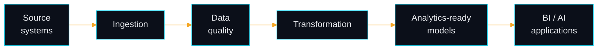

<div align="center">


# Sunil K K

**Data Engineer | Python & SQL | Microsoft Fabric | Analytics & AI**

I build reliable data pipelines, transform raw data into trusted datasets, and turn data into actionable intelligence.

<a href="https://protfolio-sunil-kulali.vercel.app/"></a>
<a href="https://www.linkedin.com/in/sunilkulali"></a>
<a href="#signature-projects"></a>
<a href="mailto:sunilkulali638@gmail.com"></a>

<sub>Open to entry-level Data Engineer, Analytics Engineer and Data Analyst roles · Bengaluru, India</sub>

</div>

---

## About

```sql
SELECT 'Sunil K K'                                         AS name,
       'Bengaluru, India'                                  AS based_in,
       'Microsoft Fabric Data Engineer Associate (DP-700)' AS certified,
       'entry-level data / analytics / ML engineering'     AS open_to
FROM   engineer
WHERE  data_quality = 'non-negotiable';
```

I'm an early-career data engineer with hands-on experience from a Data Analyst internship (IT Vedant) and a Machine Learning internship (CODE-B Solutions), plus end-to-end projects across SQL, BI and applied ML. I care most about getting data from messy source to trusted, analytics-ready form.

- **Ingestion and transformation:** cleaning and reshaping raw data with Python and SQL
- **Modeling and analysis:** SQL-first analytical queries and data modeling
- **Insight delivery:** Power BI and Tableau dashboards for business questions
- **Applied ML:** classification models taken from notebook to deployed app
- **Direction:** production-oriented data systems on Microsoft Fabric

---

## Signature Projects

### Data engineering, SQL and BI

> **[Pizza Sales Analysis](https://github.com/SunilKulali/SQL-Project-Pizzas-Sales-Analysis)** · `SQL`<br/>
> **Problem:** Sales data spread across orders, customers and products needs to become answers.<br/>
> **Approach:** SQL analysis using joins, CTEs and window functions.<br/>
> **Outcome:** A set of analytical queries answering business questions on sales performance.<br/>
> [Repository →](https://github.com/SunilKulali/SQL-Project-Pizzas-Sales-Analysis)

> **[Coffee Day Sales Insights](https://github.com/SunilKulali/Coffee-Day-Sales-Insights-SQL-Data-Analysis)** · `SQL`<br/>
> **Problem:** A coffee chain's sales, customer, city and product data had no central analytical view.<br/>
> **Approach:** Designed a SQL database and wrote advanced analytical queries on top of it.<br/>
> **Outcome:** Queries for product- and city-level performance analysis.<br/>
> [Repository →](https://github.com/SunilKulali/Coffee-Day-Sales-Insights-SQL-Data-Analysis)

> **[Credit Card Transaction Report](https://github.com/SunilKulali/Credit-Card-Transaction-Report)** · `Tableau`<br/>
> **Problem:** Spending patterns and performance metrics were buried in raw transaction data.<br/>
> **Approach:** Processed the transaction data and visualized it in Tableau.<br/>
> **Outcome:** An interactive dashboard of transaction trends and customer spending behavior.<br/>
> [Repository →](https://github.com/SunilKulali/Credit-Card-Transaction-Report)

> **[Crimes Against Women: Power BI](https://github.com/SunilKulali/Decoding-Crimes-Against-Women-2001-2022-)** · `Power BI` `DAX`<br/>
> **Problem:** Multi-year, multi-state crime data was hard to explore as a whole.<br/>
> **Approach:** Built a Power BI dashboard with DAX measures.<br/>
> **Outcome:** A dashboard for exploring crime types by state and year.<br/>
> [Repository →](https://github.com/SunilKulali/Decoding-Crimes-Against-Women-2001-2022-)

### Applied machine learning

> **[Loan Approval Prediction](https://github.com/SunilKulali/Predictive-Analysis-of-Loan-Status-Using-Machine-Learning)** · `Python` `scikit-learn` `Streamlit`<br/>
> **Problem:** Classify loan applications as approved or defaulted from applicant and financial details.<br/>
> **Approach:** Preprocessing and EDA, then Logistic Regression, Random Forest, Decision Tree and KNN, evaluated on accuracy, precision, recall, F1 and confusion matrix, with hyperparameter tuning.<br/>
> **Outcome:** 87.6% accuracy reported in the repository, with Random Forest generalizing better than Logistic Regression. Deployed as a Streamlit app.<br/>
> [Repository →](https://github.com/SunilKulali/Predictive-Analysis-of-Loan-Status-Using-Machine-Learning) · [Live demo →](https://loan-approval-app-9bhxipva5x7vk2rt4nz3wt.streamlit.app/)

> **[Heart Disease Prediction](https://github.com/SunilKulali/Heart-Disease-Prediction-using-Machine-Learning)** · `Python` `Jupyter`<br/>
> **Problem:** Estimate the likelihood of heart disease from patient health indicators.<br/>
> **Approach:** Trained and evaluated classification models in a Jupyter notebook.<br/>
> **Outcome:** A reproducible notebook workflow, from health-indicator data to a risk prediction.<br/>
> [Repository →](https://github.com/SunilKulali/Heart-Disease-Prediction-using-Machine-Learning)

---

## Currently Building

> **DataOps Sentinel** · *In progress*<br/>
> My flagship data engineering project, focused on reliable ingestion, data-quality checks and pipeline monitoring.<br/>
> **Planned stack:** Python · SQL · Microsoft Fabric<br/>
> <sub>Not yet released. This section will link to the repository once there is something to review.</sub>

<!-- Edit the focus and stack lines above so they match the real scope of DataOps Sentinel. -->

### Roadmap

- [x] Microsoft Fabric Data Engineer Associate (DP-700)
- [ ] Ship DataOps Sentinel with documented schemas and run instructions
- [ ] Add automated tests and data-quality checks to pipeline projects
- [ ] Build idempotent, repeatable ingestion on Microsoft Fabric

---

## How I Engineer Data



*Source Systems → Ingestion → Data Quality → Transformation → Analytics-Ready Models → BI / AI Applications*

These are the principles I practice and am building toward, not a claim that every project above implements all of them:

- **Reproducible pipelines:** the same inputs give the same outputs
- **Data quality checks:** validate early and fail loudly
- **Idempotent ingestion:** re-running a load never duplicates data
- **Clear schemas and documentation:** someone else can pick it up
- **Automated testing:** changes are checked, not assumed
- **Reliable, explainable results:** numbers a stakeholder can trust and trace

---

## Tech Stack

**Data Engineering**<br/>


**Analytics and BI**<br/>


**AI and Machine Learning**<br/>


**APIs and Developer Tools**<br/>


---

## GitHub Activity

<p align="center">
  
  
</p>

---

## Certifications and Education

- **Microsoft Certified: Fabric Data Engineer Associate (DP-700)**
- **IBM:** Data Analysis with Python · Databases & SQL for Data Science with Python · Machine Learning with Python
- **Accenture:** Data Analytics & Visualization Job Simulation
- **B.E. Computer Science & Engineering**, VTU · CGPA 7.82

---

## Get in Touch

The best ways to reach me are [email](mailto:sunilkulali638@gmail.com) or [LinkedIn](https://www.linkedin.com/in/sunilkulali). I'm happy to talk about data engineering, SQL, BI or applied ML roles.

<div align="center">

*Trustworthy data first. Dashboards and models follow.*


</div>
