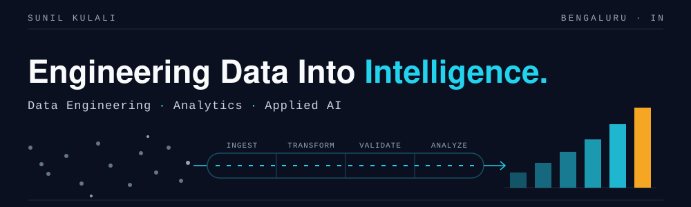
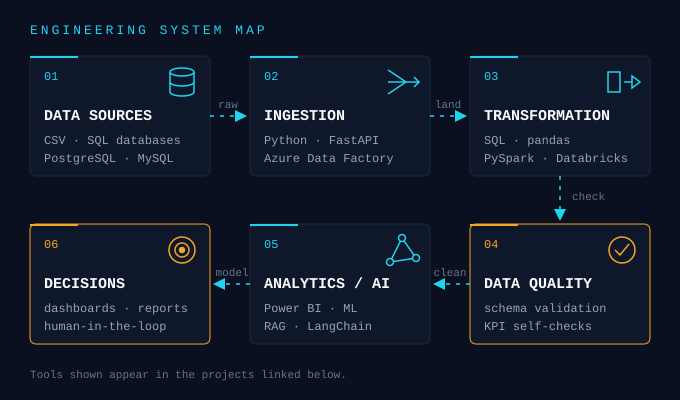
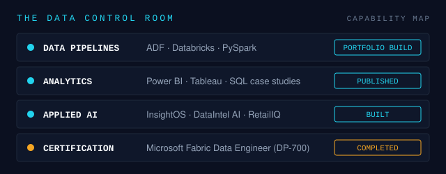

I build data pipelines, analytical models, and AI workflows that turn raw data into answers people can trust. I'm an early-career engineer: Microsoft Fabric certified (DP-700), a Data Analyst internship behind me, and the systems below as proof of work.

[\[ EXPLORE SYSTEMS \]](#selected-systems)&nbsp;&nbsp;[\[ ENGINEERING NOTES \]](#engineering-log)&nbsp;&nbsp;[\[ CONNECT \]](#connect)

---

## ENGINEERING SYSTEM MAP



How I think about a data product: nothing reaches a decision until it has been ingested, transformed, and checked.

---

## TECHNOLOGY CONSTELLATION

`●` built into projects &nbsp;·&nbsp; `◐` used at portfolio scale &nbsp;·&nbsp; `○` certified or actively learning

**DATA ENGINEERING**  
Python ● &nbsp;·&nbsp; SQL ● &nbsp;·&nbsp; ETL/ELT ◐ &nbsp;·&nbsp; PySpark ◐ &nbsp;·&nbsp; Databricks ◐ &nbsp;·&nbsp; Microsoft Fabric ○

**ANALYTICS**  
Power BI ● &nbsp;·&nbsp; DAX ● &nbsp;·&nbsp; Power Query ● &nbsp;·&nbsp; Tableau ● &nbsp;·&nbsp; Excel ● &nbsp;·&nbsp; Data modeling ◐

**AI ENGINEERING**  
Machine Learning ● &nbsp;·&nbsp; FastAPI ● &nbsp;·&nbsp; LangChain ● &nbsp;·&nbsp; RAG ● &nbsp;·&nbsp; LLM applications ●

**DATA PLATFORMS**  
PostgreSQL ● &nbsp;·&nbsp; MySQL ◐ &nbsp;·&nbsp; Azure (Data Factory, Key Vault, storage, SQL Server) ◐ &nbsp;·&nbsp; Google Cloud ◐

---

## SELECTED SYSTEMS

`01 — 04`

### 01 · INSIGHTOS

`AI BUSINESS INTELLIGENCE` &nbsp;·&nbsp; `PORTFOLIO PROJECT`

*Problem: business teams wait on analysts for answers; how do you let them ask in plain language without losing control of the SQL that runs?*

```text
Business question
  → LangGraph workflow (SQL analytics · root-cause · forecasting)
  → text-to-SQL + RAG  →  SQL validation  →  PostgreSQL
  → insights & automated reports      [ human approval · audit log ]
```

**Stack:** Python · FastAPI · Next.js · PostgreSQL · LangGraph · RAG · Google Cloud

**What I built**
- Multi-tenant architecture with RBAC, JWT authentication, and tenant-level data isolation
- Natural-language analytics with SQL validation before queries execute
- Audit logging, AI observability, and human-in-the-loop approvals around LLM output

[Repository →](https://github.com/SunilKulali/plusedataai)

---

### 02 · RETAILIQ

`RETAIL ANALYTICS + ML` &nbsp;·&nbsp; `PORTFOLIO PROJECT`

*Problem: raw retail transactions don't tell a business who its customers are, what looks abnormal, or what to recommend.*

```text
Transactions
  → orchestration & streaming (Docker · Airflow · Kafka)
  → models: K-Means · Isolation Forest · XGBoost · collaborative filtering
  → FastAPI  →  React / Vite dashboards
```

**Stack:** Python · FastAPI · React · Vite · XGBoost · scikit-learn · Docker · Airflow · Kafka

**What I built**
- Customer segmentation, anomaly detection, and recommendation models behind an API
- A web front end for business reporting on top of those outputs

[Repository →](https://github.com/SunilKulali/CrazyKart-Retail-data)

---

### 03 · DATAINTEL AI

`AI DATA PREPARATION + ANALYSIS` &nbsp;·&nbsp; `PORTFOLIO PROJECT`

*Problem: real datasets arrive messy and undocumented. Before anyone analyzes them, they need profiling, validation, and cleanup.*

```text
Upload
  → Pulse (profile)  →  Link Finder (entities · join keys)
  → Data Checker (schema validation · Data Health Score)
  → Polish & Dashboard (auto-clean · BI view)
  → Ask Anything (RAG Q&A over the dataset)
```

**Stack:** Python · FastAPI · React · LangChain · FAISS · OpenAI API

**What I built**
- A schema-agnostic KPI classification engine that detects currency, percentage, and ID columns on any dataset
- Fixes for aggregation bugs (percentages summed instead of weighted-averaged) and primary-key detection
- Row-count logging at each pipeline stage, and a self-validation layer that recomputes KPIs and flags more than 1% drift
- A backend regression suite validated across two structurally different datasets

[Repository →](https://github.com/SunilKulali/plusedataai)

---

### 04 · HEALTHCARE DATA LAKE

`AZURE DATA ENGINEERING` &nbsp;·&nbsp; `IN PROGRESS` &nbsp;·&nbsp; `PORTFOLIO BUILD`

*Problem: practice the full path of an enterprise healthcare data platform: generate, orchestrate, clean, and (next) serve analytics.*

```text
Data generation
  → Azure Data Factory orchestration
  → Databricks / PySpark cleaning
  → analytics layer                     [ not yet built ]
```

**Stack:** Azure Data Factory · Databricks · PySpark · Azure Storage · Azure SQL · Key Vault

**Completed so far:** the data-generation, ADF orchestration, and Databricks/PySpark cleaning modules, on real provisioned Azure resources. Repository link will be added when the project is public.

<!--
TEMPLATE FOR A FUTURE SLOT (fill only with what the repo really implements):

### 05 · YTRAG
`RETRIEVAL-AUGMENTED GENERATION` · `STATUS`
*Problem:* ...
```text
source → document processing → embeddings → vector search → LLM answer
```
**Stack:** ...
**What I built:** ...
[Repository →](https://github.com/SunilKulali/YOUR-REPO)
-->

---

## THE DATA CONTROL ROOM



[Pipelines](#04--healthcare-data-lake) &nbsp;·&nbsp; [Analytics repos](https://github.com/SunilKulali?tab=repositories) &nbsp;·&nbsp; [Applied AI](#01--insightos) &nbsp;·&nbsp; [Portfolio](https://protfolio-sunil-kulali.vercel.app/)

---

## ENGINEERING LOG

```text
[ DATAINTEL AI ]       / [ schema-agnostic KPI classification + drift self-check ] / [ BUILT ]
[ INSIGHTOS ]          / [ SQL validation, audit logging, RBAC, tenant isolation ] / [ BUILT ]
[ HEALTHCARE LAKE ]    / [ ADF orchestration + Databricks/PySpark cleaning ]       / [ MODULES DONE ]
[ DATAOPS SENTINEL ]   / [ flagship data engineering build ]                       / [ IN PROGRESS ]
[ FABRIC DP-700 ]      / [ Microsoft Fabric Data Engineer Associate ]              / [ COMPLETED 2026-08 ]
```

<!-- To update: add a line at the top, keep the three-part format, and use only real statuses (BUILT, IN PROGRESS, LEARNING, COMPLETED). -->

---

## CREDENTIALS

- **Microsoft Certified: Fabric Data Engineer Associate (DP-700)**, completed
- **B.E. Computer Science Engineering**, VTU, 2024
- **Internships:** Data Analyst, IT Vedant · Machine Learning, CODE-B Solutions
- **Also:** IBM (Data Analysis with Python, Databases & SQL, Machine Learning with Python) · Accenture Data Analytics & Visualization Job Simulation

<details>
<summary>GitHub activity (live cards)</summary>


If the cards don't load, see [all repositories](https://github.com/SunilKulali?tab=repositories).

</details>

---

## CONNECT

Open to entry-level Data Engineer, Analytics Engineer, Data Analyst, and AI/ML Engineer roles in Bengaluru and remote.

[sunilkulali638@gmail.com](mailto:sunilkulali638@gmail.com) &nbsp;·&nbsp; [LinkedIn](https://www.linkedin.com/in/sunilkulali) &nbsp;·&nbsp; [Portfolio](https://protfolio-sunil-kulali.vercel.app/)

<sub>Reliable data first. Intelligence second.</sub>
